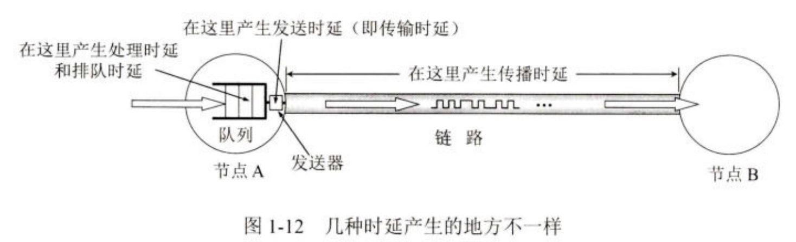

# 复习日记-计算机网络

## 第 1 章 概述

> 本章主要介绍计算机网络的基本概念，没有涉及较多新知识，考试只需要关注性能指标中的几个概念和计算公式。

### 区分发送时延与传播时延

先说清**时延**是什么：数据传输需要时间，传输消耗的时间就是**时延**，也叫延迟，迟延等等。

- 发送时延：出现在主机或路由器**内部**，大小取决于发送**数据帧大小**和**发送速率**。
- 传播时延：出现在数据传输的信道上，大小取决于传播距离和信道种类。

此外还有处理时延和排队时延，顾名思义就是处理数据和等待转发消耗的时间，考试计算时通常忽略。

> 一个容易搞混的例子：有人把高速网络链路比喻为高速公路，这是不恰当的。高速网络链路提高的是发送速率，影响的是**发生时延**，而高速公路更类似于降低传播时延——两者在原理上有根本区别。

### 时延带宽积、往返时间（RTT）有什么用

定义：

- 时延带宽积 = 传播时延 * 带宽（最高数据率）
- 往返时间 = 双向交互中数据接收方返回确认消息消耗的时间
